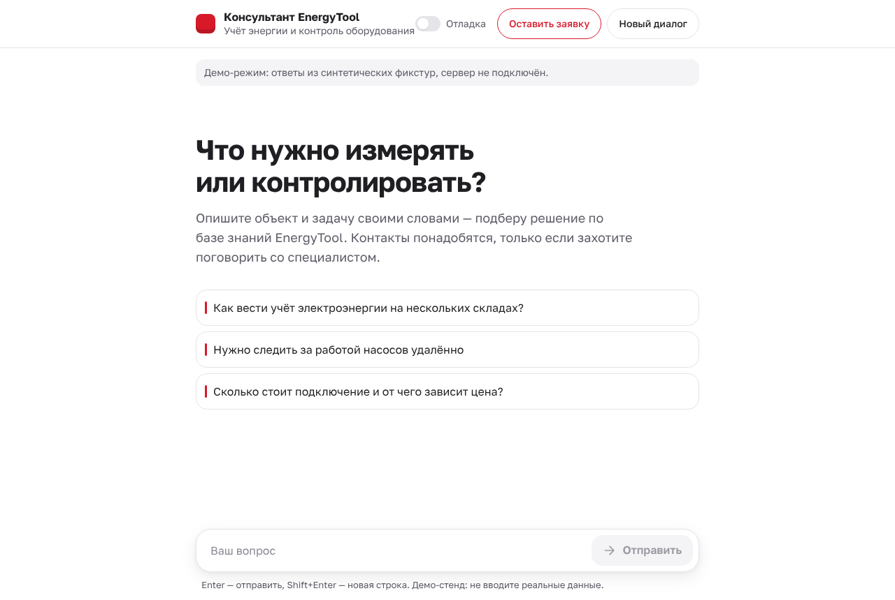
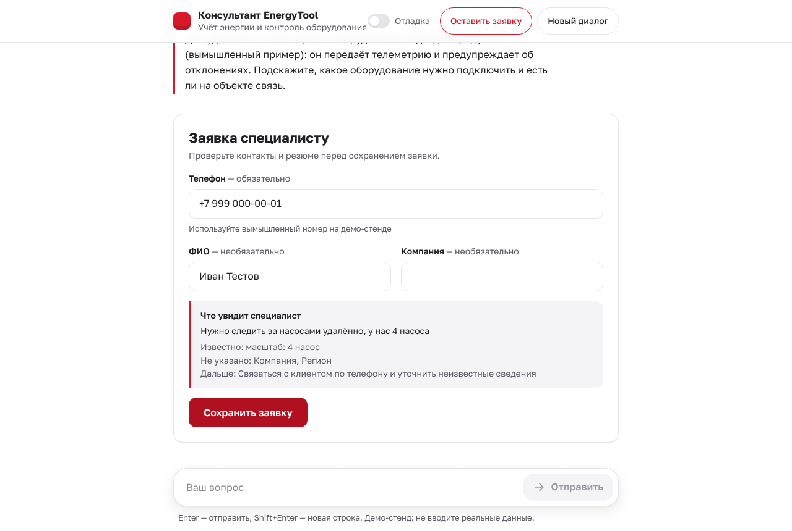
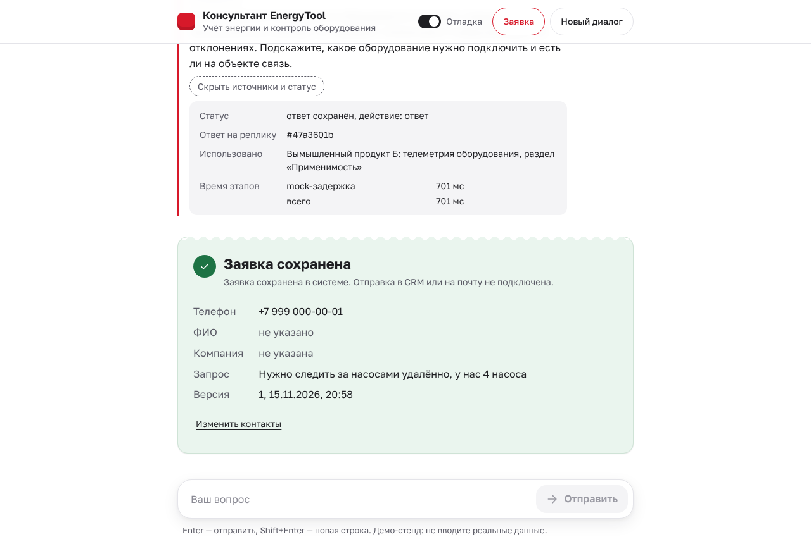
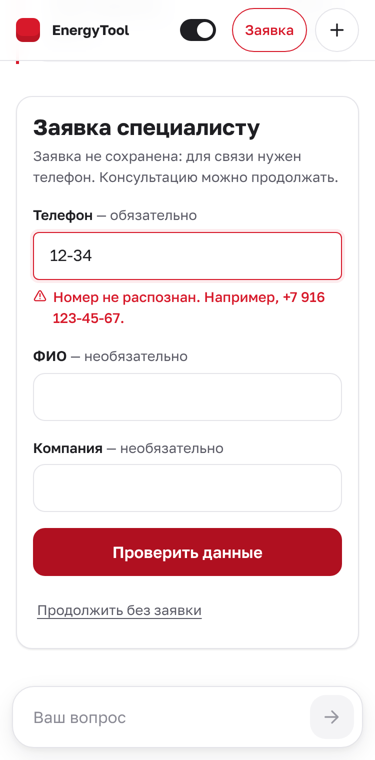
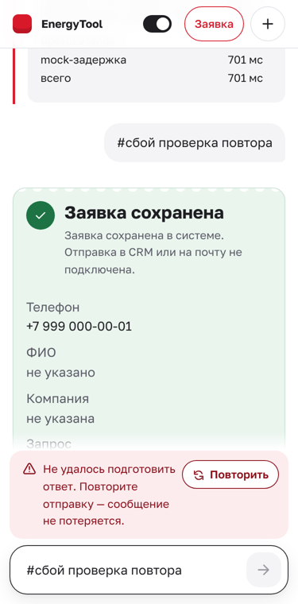
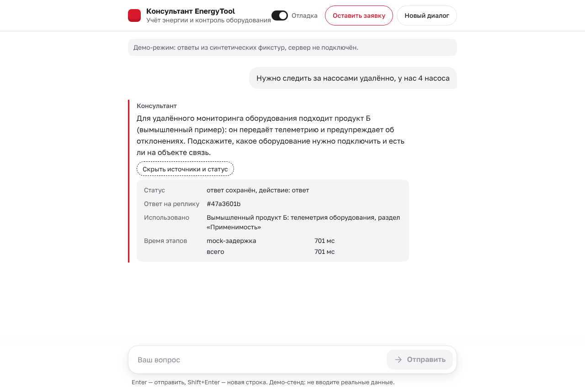

# Веб-чат консультанта (U1–U5)

React + TypeScript + CSS Modules в папке `web/`. Один вход: пользователь сразу попадает в чат, без выбора сегмента или роли (QA03). Сборку отдаёт тот же FastAPI на `:8080`; прежний демо-чат остался на `/demo`.



## Запуск

| Что | Команда | Где открыть |
|---|---|---|
| Всё вместе (Docker) | `CASEMTC_BUILD_SHA=$(git rev-parse HEAD) docker compose up --build -d` | http://localhost:8080 |
| Только интерфейс на фикстурах | `cd web && npm ci && npm run dev` + `?mock=1` в адресе | http://localhost:5173/?mock=1 |
| Интерфейс против локального backend | `uvicorn backend.app:app --port 8080`, затем `cd web && npm run dev` | http://localhost:5173 |
| Тесты | `cd web && npm test` (15 тестов: состояния, сценарии, адаптеры) | — |

Нужен Node.js 22.12+. Без собранного `web/dist` backend на `/` показывает прежний демо-чат.

## Конфигурация

Значения задаются в `web/.env` (образец `web/.env.example`), в коде адресов нет.

| Переменная | По умолчанию | Смысл |
|---|---|---|
| `VITE_API_BASE_URL` | пусто — тот же origin | Адрес backend |
| `VITE_API_MODE` | `http` | `mock` — синтетические фикстуры без сервера |
| `VITE_DEBUG_TOGGLE` | `false` | Показывать переключатель «Отладка»; также `?debug=1` |
| `VITE_DEV_PROXY_TARGET` | `http://127.0.0.1:8080` | Только для `npm run dev` |

Всё с префиксом `VITE_` попадает в браузерный бандл, поэтому секретов там нет и быть не может: ключи LLM живут только в окружении backend. Сессия защищена токеном вкладки (`X-Client-Token`), который выдаёт сервер.

## Структура

```
web/src/
  config.ts                 env → AppConfig (режим, адрес, отладка)
  api/
    adapter.ts              интерфейс ConsultationApi, ApiError, request_id
    httpAdapter.ts          /api/v1 backend; ошибки → ApiError с полем формы
    mockAdapter.ts          тот же контракт на фикстурах (идемпотентность, invalid_phone, stale_offer, сбой «#сбой»)
    types.ts                DTO контракта 1.0.0 (зеркало backend/api_models.py)
  fixtures/consultation.json  синтетические ответы, документы, примеры вопросов
  state/
    chatState.ts            reducer: фазы, epoch, pending, черновик, ошибки полей
    useConsultation.ts      оркестратор: отправка, повтор, новый диалог, заявка, отладка
    storage.ts              sessionStorage вкладки: сессия, реплика в пути, черновик
  components/
    TopBar                  название, «Отладка», «Оставить заявку», «Новый диалог»
    EmptyState              приветствие и три примера вопросов
    MessageList             лента, индикатор ожидания, место для формы заявки
    DebugDisclosure         источники и статус выбранного ответа
    Composer                поле ввода, отправка, уведомление с «Повторить»
    LeadPanel               форма → предпросмотр → квитанция сохранённой заявки
  lib/phone.ts              мягкая проверка и формат телефона (как core/phone.py)
  styles/tokens.css         цвета, шрифт Golos Text, шкалы, движение
```

Компоненты не знают ни URL, ни `fetch`: всё идёт через `ConsultationApi`. Mock и HTTP взаимозаменяемы, и тесты сценариев гоняются на mock.

## Состояния и ошибки

| Ситуация | Что видит пользователь | Как устроено |
|---|---|---|
| Загрузка | Скелет на месте ленты, без скачка | `phase: booting` |
| Пусто | Вопрос-заголовок и три примера | Нет сообщений и формы |
| Ответ в пути | Реплика клиента сразу в ленте, три точки, кнопка «Отправляем» заблокирована | `sending`, синхронный замок `sendLock` |
| Двойная отправка | Вторая не уходит | Замок + один `request_id` на реплику |
| Обрыв или 5xx | «Связь прервалась… нажмите «Повторить»», текст остаётся в поле | `pending` в sessionStorage; повтор тем же `request_id`, сервер вернёт сохранённый ответ |
| Неповторяемая ошибка | Сообщение, текст остаётся для правки | `dropPending` |
| Новый диалог во время ответа | Пустой чат; опоздавший ответ не появится | `epoch`: результат старой сессии отбрасывается |
| Перезагрузка вкладки | Та же переписка; неотправленная реплика с предложением повторить | Сессия и `pending` из sessionStorage |
| Ошибка поля | Текст под полем, рамка, фокус в поле | `invalid_phone` → `fieldErrors.phone` (`aria-invalid`, `aria-describedby`) |

## Заявка

1. «Оставить заявку» в шапке есть всегда; консультант также открывает форму, когда клиент просит связь.
2. **Проверить данные.** Сервер нормализует телефон и собирает резюме. ФИО и компания необязательны: с одним валидным телефоном заявку можно сохранить (QA05).
3. **Сохранить заявку.** Сохраняется ровно показанный предпросмотр (`offer_id`); любая правка возвращает к проверке. Повторный клик использует тот же ключ идемпотентности, дубль не создаётся.
4. **Квитанция.** «Заявка сохранена в системе. Отправка в CRM или на почту не подключена». Звонок и отправку менеджеру интерфейс не обещает (QA06).
5. «Продолжить без заявки» — консультация продолжается, история сохраняется.

| Предпросмотр | Сохранено |
|---|---|
|  |  |

| Ошибка телефона (375 px) | Сбой и повтор (375 px) |
|---|---|
|  |  |

## Отладка

Переключатель «Отладка» (виден при `VITE_DEBUG_TOGGLE=true` или `?debug=1`). Под каждым ответом появляется «Источники и статус»: статус хода, действие, попытка, к какой реплике привязан ответ, использованные документы, найденные, но не использованные, время этапов и этап ошибки. Тексты фрагментов БЗ, токены, идентификаторы фрагментов и заголовки не выводятся (белый список полей в `DebugDisclosure`).



## Фикстура

`web/src/fixtures/consultation.json`, фрагмент:

```json
{
  "topics": [{
    "keywords": ["учёт", "счётчик", "электроэнерг"],
    "answer": "Для учёта на нескольких объектах подойдёт продукт А (вымышленный пример)…",
    "action": "answer",
    "evidence": [{ "evidence_id": "syn-001#0", "doc_title": "Вымышленный продукт А: учёт энергопотребления", "section": "Назначение" }],
    "used": ["syn-001#0"]
  }],
  "status_text": { "saved": "Заявка сохранена в системе. Отправка в CRM или на почту не подключена." },
  "demo_contact": { "phone": "+7 999 000-00-01", "full_name": "Иван Тестов", "company": "ООО «Пример»" }
}
```

Продукты, документы и контакты вымышленные; фрагментов закрытой БЗ нет.

## Дизайн

Белый фон, графитовый текст (`#1F1F23`), один красный акцент (`#D7192A`) для действий, рамки ответа и фокуса. Гарнитура Golos Text (сделана для кириллицы, подключена из пакета, без внешних CDN). Ответ консультанта — текст с красной линией слева, а не «пузырь»; реплики клиента — серые справа. Сохранённая заявка оформлена как квитанция. Цвет никогда не несёт смысл в одиночку: у ошибки и успеха всегда есть иконка и текст. Контраст текста не ниже 4,5:1, цели касания от 44 px, видимый фокус, `prefers-reduced-motion` отключает анимации, нет горизонтальной прокрутки на 375 px.

Логотипы, названия и фирменные шрифты других компаний не используются.

## Проверено

- `npm test`: 15/15 (stale-ответ, дубль отправки, двойное сохранение, ошибка у поля, повтор тем же `request_id`, отладка без технических полей, адаптеры, конфиг).
- `pytest`: 242 passed (раздача сборки и откат на демо — `tests/test_web_bundle.py`).
- Браузер (Chrome, 1280×860 и 375×760), mock и настоящий backend со StubEngine: путь вопрос → «Свяжите со специалистом» → неверный телефон → исправление → предпросмотр → двойной клик «Сохранить» (на сервер ушёл один `lead/save`) → квитанция; сбой → «Повторить»; отладка. Ошибок в консоли нет.
- Не проверено: сборка Docker-образа с новым этапом `node` (нужен доступ к Docker Hub и npm при сборке) и работа на настоящем RagConsultant.
